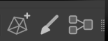
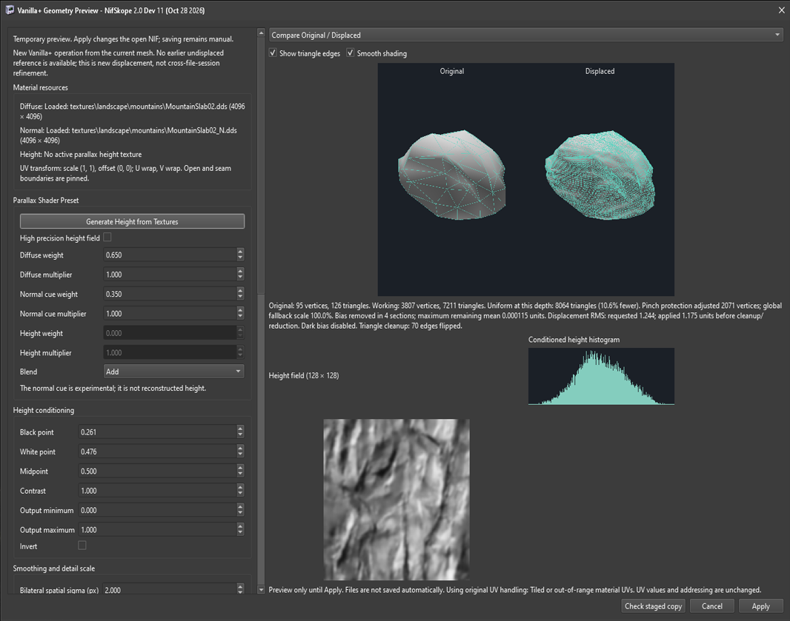
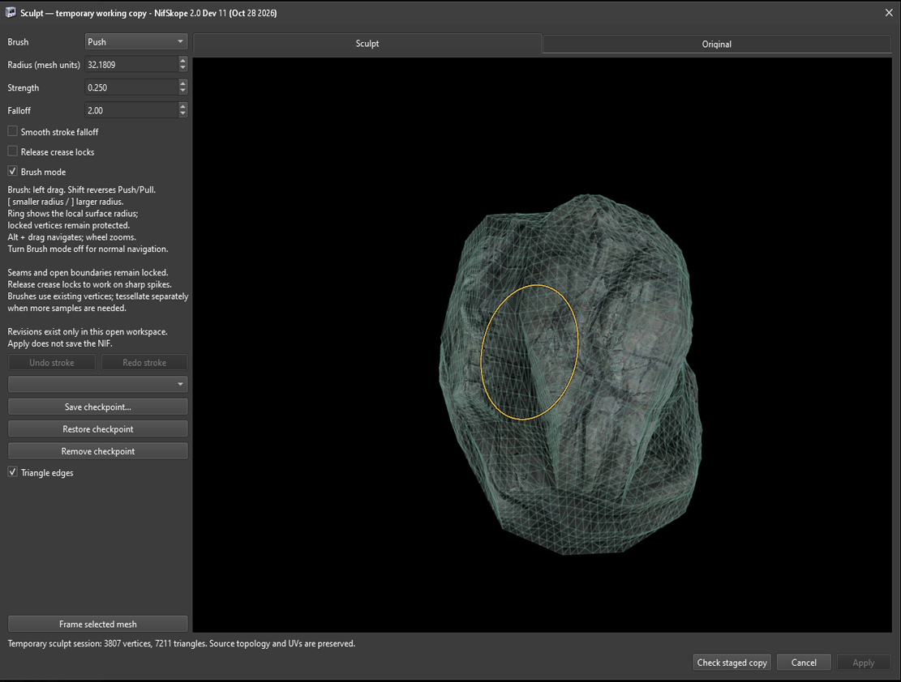
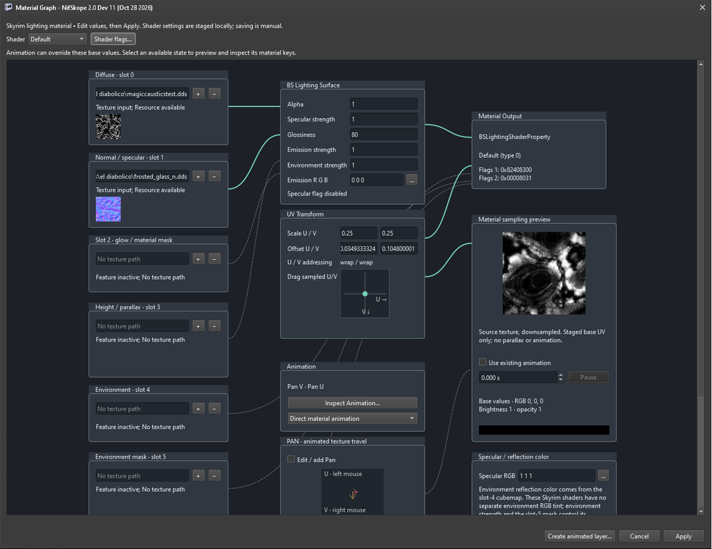
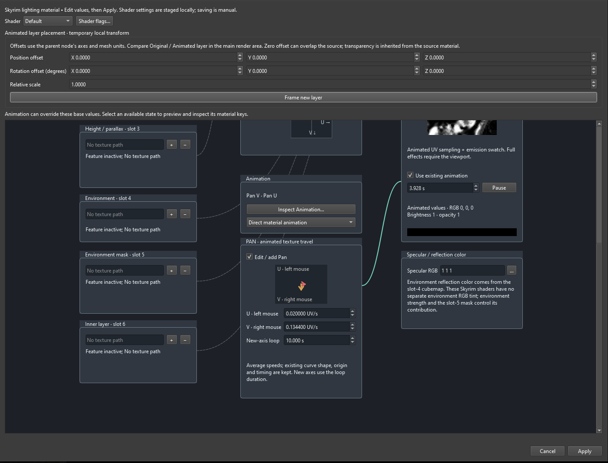
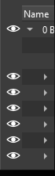

# NifSkope Vanilla+ RC1

Release candidate review snapshot: **2026-11-06**.

This is a customized NifSkope 2.0.dev11 build with Vanilla+ Geometry, Sculpt,
Material Graph and viewport visibility tools. It is a candidate for manual
review and publication, not an official upstream NifSkope release. The binary
still reports the inherited `2.0.dev11` application version; RC1 identifies this
package, not a rewritten version resource.

## Start here

Extract the complete Windows archive into a writable folder and run
`NifSkope.exe`. Keep the DLLs, plugins, XML schemas, style and shaders beside it.
Qt and a compiler do not need to be installed to use the staged runtime.
Configure your game/resource folders in NifSkope before using texture-based
features. Your existing NifSkope preferences may be reused; no preferences,
game archives, meshes or textures are supplied by this package.

The Windows build is x64, targets AVX and F16C (`noavx2=1`), and requests an
OpenGL 4.2 core context. AVX2 is not required by the application build. Other
operating systems, older CPUs and fresh machines have not been validated for
this candidate. The tested kit is MSYS2 UCRT64, GCC 16.2.0 and Qt 6.12.0.

## Vanilla+ tools at a glance

The new workspaces are accessed from the Vanilla+ toolbar in NifSkope. Select a compatible mesh or shader property before opening its editor. All edits remain temporary until **Apply**; saving the NIF to disk is a separate step.

### Geometry and tessellation

Generate and condition height information from textures, preview tessellation and displacement, inspect geometry statistics, and stage changes before applying them.

### Sculpt workspace

Edit mesh geometry with brush controls, protected boundaries, local undo/redo, and checkpoints while retaining the original for comparison.

### Material Graph

Inspect and adjust Skyrim lighting shader texture inputs, shader settings, UV transforms, and material animation in a dedicated graph window.

### Animated textures

The Material Graph includes directional U/V panning controls, speed and loop settings, and a sampling preview. Use the graph's animation controls to inspect or stage texture movement.

### Viewport visibility

Use the eye icons beside applicable blocks in the main NifSkope hierarchy to hide or show geometry in the viewport without editing the NIF's stored visibility.

## Documentation

- [Geometry features and implementation status](docs/vanilla-plus-progress.md)
- [Sculpt workspace](docs/sculpt-workspace.md)
- [Material Graph instructions](docs/material-graph-instructions.md)
- [Viewport visibility](docs/viewport-visibility.md)
- [Full candidate changelog](CHANGELOG.md)
- [Displacement limitations](docs/displacement-local-limits.md)
- [Source build and tests](docs/local-build.md)
- [Geometry implementation and verification notes](docs/vanilla-plus-progress.md)
- [Build and deployment scripts](scripts/)
- [Third-party dependency revisions](docs/local-build.md)

The source package contains a complete vendored source snapshot. It does not
need submodule downloads for the included dependencies. The top-level source
README and changelog identify this candidate; their originals remain under
`docs/upstream/`. Original application licensing and credits are retained.

